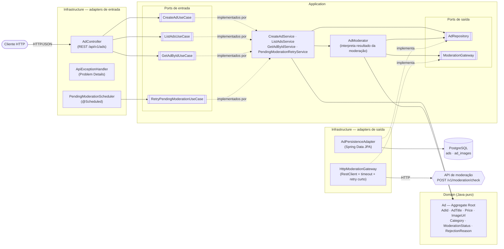
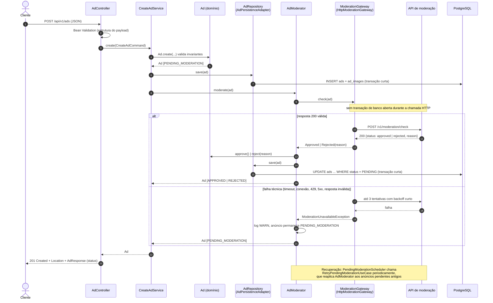

# Marketplace Ads API — Desafio Técnico Backend (Grupo OLX)

Serviço de **inserção e listagem de anúncios** de um marketplace. Todo anúncio passa pela **API de moderação** fornecida
pela OLX (mock em [`backend/api-mock`](backend/api-mock)) antes de ser publicado. Os reprovados ficam com status
`rejected` e o motivo visível.

> Enunciado original: [`backend/README.md`](backend/README.md) · Contrato da moderação: [`backend/api-mock/docs-candidato/API.md`](backend/api-mock/docs-candidato/API.md)

**Documentos:** [DECISIONS.md](DECISIONS.md) · [AI_USAGE.md](AI_USAGE.md) · [Análise de requisitos](docs/REQUIREMENTS_ANALYSIS.md) ·
[Revisão final e resultados](docs/FINAL_REVIEW.md) · [Guia de apresentação](docs/PRESENTATION_GUIDE.md)

---

## Sumário

1. [O que a API faz](#o-que-a-api-faz)
2. [Tecnologias](#tecnologias)
3. [Arquitetura](#arquitetura)
4. [Fluxo de criação e moderação](#fluxo-de-criação-e-moderação)
5. [Como executar](#como-executar)
6. [Como executar os testes](#como-executar-os-testes)
7. [Exemplos de uso](#exemplos-de-uso)
8. [Configuração](#configuração)

---

## O que a API faz

| Método | Endpoint | Descrição |
|---|---|---|
| `POST` | `/api/v1/ads` | Cria o anúncio e o envia à moderação. Retorna `201` com o status resultante: `approved`, `rejected` (com `rejectionReason`) ou `pending_moderation` (moderação indisponível; um job reprocessa). |
| `GET` | `/api/v1/ads?category=&page=&size=` | Lista **somente anúncios aprovados**, do mais recente para o mais antigo. `page` começa em 0; `size` de 1 a 100 (padrão 20). |
| `GET` | `/api/v1/ads/{id}` | Detalhe de um anúncio em qualquer status, com o motivo da reprovação quando houver. `404` se não existir. |

**Regras:** título de 10 a 100 caracteres, preço maior que zero (até 2 casas), descrição obrigatória, 1 a 10 imagens
(URLs http/https), categoria entre `eletronicos`, `moveis`, `veiculos`, `imoveis`, `esportes` e `colecionaveis`.
As faixas de preço por categoria, o contato no texto e os itens proibidos são avaliados pela moderação.

Erros seguem **Problem Details (RFC 9457)**, com `code`, `errors[]` por campo e `correlationId` (o mesmo do header
`X-Request-Id`).

## Tecnologias

Java 21 · Spring Boot 3.5 (Web, Validation, Data JPA, Actuator) · PostgreSQL 16 · Flyway · Springdoc OpenAPI ·
JUnit 5 · Mockito · Testcontainers 1.21.4 · WireMock · JaCoCo · Docker Compose.
A justificativa de cada escolha está em [DECISIONS.md](DECISIONS.md).

## Arquitetura

Monólito modular com **arquitetura hexagonal**: o domínio é Java puro; a aplicação define casos de uso e portas; a
infraestrutura implementa REST, JPA, o cliente HTTP da moderação e o agendador.



### Organização dos pacotes

```text
src/main/java/br/com/olx/marketplace
├── domain/ad/                 Ad (Aggregate Root), AdTitle, Price, ImageUrl, Category,
│                              ModerationStatus, RejectionReason, exceções de domínio
├── application/
│   ├── port/in/               CreateAdUseCase, ListAdsUseCase, GetAdByIdUseCase,
│   │                          RetryPendingModerationUseCase, PageResult
│   ├── port/out/              AdRepository, ModerationGateway, ModerationDecision
│   └── service/               implementações dos casos de uso + AdModerator
└── infrastructure/
    ├── adapter/in/web/        AdController, DTOs, ApiExceptionHandler, CorrelationIdFilter
    ├── adapter/in/scheduler/  PendingModerationScheduler
    ├── adapter/out/persistence/  entidade JPA, Spring Data, AdPersistenceAdapter
    ├── adapter/out/moderation/   HttpModerationGateway (RestClient)
    └── config/                composição dos casos de uso (ApplicationConfig)
src/main/resources/db/migration/   migrations Flyway
```

## Fluxo de criação e moderação

1. O anúncio é validado pelo domínio e gravado como `PENDING_MODERATION`.
2. A moderação é chamada **fora de transação de banco**: timeout, até 3 tentativas em erros transitórios (timeout, I/O,
   429 com `Retry-After`, 5xx).
3. A decisão é gravada com `UPDATE ... WHERE status = 'PENDING_MODERATION'`, o que protege contra moderação concorrente.
4. **Falha técnica nunca vira reprovação:** o anúncio continua pendente e o `PendingModerationScheduler` reprocessa
   (a cada 30 s, lotes de 10).



## Como executar

### Pré-requisitos

- **Docker Desktop** (no Windows, com WSL 2 e virtualização habilitada na BIOS).
- Para rodar os testes: **Java 21** e **Maven 3.9+**.

### Subir tudo (API + PostgreSQL + mock de moderação)

```bash
docker compose up --build -d
docker compose ps        # app, moderation-api e postgres devem ficar "healthy"
```

| Serviço | URL |
|---|---|
| API | http://localhost:8080/api/v1/ads |
| Swagger UI | http://localhost:8080/swagger-ui.html |
| OpenAPI (JSON) | http://localhost:8080/v3/api-docs |
| Health | http://localhost:8080/actuator/health |
| Mock de moderação | http://localhost:8787 |

O mock é construído a partir de `backend/api-mock` **sem nenhuma alteração**, com a configuração padrão dele: latência
de 100 ms a 2 s e 20% de HTTP 500. Por isso, alguns anúncios podem nascer `pending_moderation` e ser aprovados pelo job
cerca de 30 s depois.

### Carregar os anúncios de exemplo (opcional)

```bash
docker compose --profile seed run --rm seed
```

O script `scripts/seed-ads.mjs` lê `backend/api-mock/seed/ads.json` e cadastra os 57 anúncios **pela própria API**, ou
seja, cada um passa pela moderação real. O seed não traz imagens, então o script usa uma URL placeholder.

### Parar

```bash
docker compose down        # mantém os dados
docker compose down -v     # apaga também o volume do banco
```

## Como executar os testes

```bash
mvn clean verify
```

O Docker precisa estar rodando: os testes de integração sobem um PostgreSQL real via Testcontainers. Relatório de
cobertura em `target/site/jacoco/index.html`.

| Suíte | Plugin | Conteúdo |
|---|---|---|
| `*Test` (57) | Surefire | Domínio e aplicação (sem Spring) e cliente de moderação contra WireMock: aprovação, reprovação, timeout, 4xx, 5xx, 429, resposta inválida, falha de conexão |
| `*IT` (19) | Failsafe | Persistência com PostgreSQL real (migrations, imagens, paginação, filtro, integridade) e API ponta a ponta |

## Exemplos de uso

```bash
# Criar (aprovado pela moderação)
curl -X POST http://localhost:8080/api/v1/ads -H "Content-Type: application/json" -d '{
  "title": "Bicicleta aro 29 Caloi",
  "description": "Pouco uso, revisada, com nota fiscal.",
  "price": 1500.00,
  "category": "esportes",
  "images": ["https://img.example.com/bike.jpg"]
}'

# Criar (reprovado: contato no texto)
curl -X POST http://localhost:8080/api/v1/ads -H "Content-Type: application/json" -d '{
  "title": "iPhone 13 128GB seminovo",
  "description": "Chama no whatsapp para negociar.",
  "price": 3500.00,
  "category": "eletronicos",
  "images": ["https://img.example.com/iphone.jpg"]
}'

# Listar publicados por categoria
curl "http://localhost:8080/api/v1/ads?category=esportes&page=0&size=10"

# Detalhe
curl http://localhost:8080/api/v1/ads/{id}
```

> No PowerShell, use `curl.exe` e escape as aspas do JSON, ou use a coleção abaixo.

### Coleção do Insomnia com todos os cenários

[`docs/insomnia/marketplace-ads.insomnia.json`](docs/insomnia/marketplace-ads.insomnia.json) — importe no Insomnia
(*Import → From File*). São 36 requisições, cada uma com o resultado esperado na descrição:

| Pasta | Cenários |
|---|---|
| 1. API — fluxo feliz | criar (aprovado), listar com filtro e paginação, detalhe, health |
| 2. API — validação (400) | título curto e longo, preço zero, negativo e com 3 casas, sem imagens, imagem inválida, mais de 10 imagens, descrição em branco, categoria inexistente, campos ausentes, JSON malformado, parâmetros de listagem inválidos |
| 3. API — recursos e métodos | 404 de anúncio, id malformado, rota inexistente, 405 |
| 4. Moderação — reprovações | contato (whatsapp e telefone), item proibido, preço abaixo e acima da faixa, preço exatamente no limite (aprovado) |
| 5. Moderação — falhas técnicas | chamadas diretas ao mock com `x-mock-force`: 500, 429 com `Retry-After`, 400 e o campo `rejection_reason` |
| 6. Moderação — indisponibilidade real | roteiro com `docker compose stop moderation-api`: o anúncio fica `pending_moderation` e o job o aprova quando o mock volta |

Respostas reais obtidas contra o mock:

```json
{
  "id": "4d88a248-7c35-4620-8f49-3ba0f7b96442",
  "title": "iPhone 13 128GB seminovo",
  "description": "Chama no whatsapp para negociar.",
  "price": 3500.00,
  "category": "eletronicos",
  "images": ["https://img.example.com/iphone.jpg"],
  "status": "rejected",
  "rejectionReason": "contact_info_not_allowed",
  "createdAt": "2026-11-17T16:03:47.534537Z",
  "updatedAt": "2026-11-17T16:03:48.196735Z",
  "moderatedAt": "2026-11-17T16:03:48.196735Z"
}
```

```json
{
  "type": "about:blank",
  "title": "Validation failed",
  "status": 400,
  "detail": "Invalid request data",
  "instance": "/api/v1/ads",
  "code": "VALIDATION_ERROR",
  "errors": [{ "field": "title", "message": "title must have between 10 and 100 characters" }],
  "correlationId": "57ade25c-b597-4d97-9e18-fc89fb8e30e4"
}
```

## Configuração

Variáveis de ambiente lidas pela aplicação (padrões em `src/main/resources/application.yml`; exemplo em `.env.example`):

| Variável | Padrão | Descrição |
|---|---|---|
| `DB_URL` / `DB_USERNAME` / `DB_PASSWORD` | `jdbc:postgresql://localhost:5432/marketplace` / `marketplace` / `marketplace` | Banco (valores apenas para ambiente local) |
| `MODERATION_BASE_URL` | `http://localhost:8787` | URL do serviço de moderação |
| `MODERATION_CONNECT_TIMEOUT` / `MODERATION_READ_TIMEOUT` | `1s` / `2500ms` | Timeouts da chamada |
| `MODERATION_MAX_ATTEMPTS` / `MODERATION_BACKOFF` | `3` / `200ms` | Retentativa em erros transitórios (backoff dobra a cada tentativa) |
| `MODERATION_RETRY_ENABLED` / `MODERATION_RETRY_INTERVAL` | `true` / `PT30S` | Job de reprocessamento de pendentes |
| `MODERATION_RETRY_MIN_AGE` / `MODERATION_RETRY_BATCH_SIZE` | `PT30S` / `10` | Idade mínima do pendente e tamanho do lote |

No `docker compose`, os logs saem estruturados (ECS/JSON), com `correlationId`.
